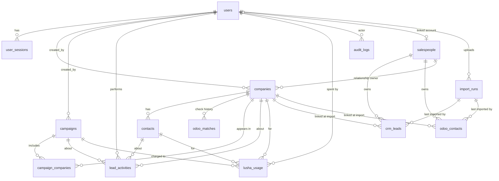

# LeadFinder AI: Architecture (Phase 3)

## 1. Overview

```
┌──────────┐   HTTPS    ┌──────────────────────┐  /api/* (server-side)  ┌──────────────┐     ┌──────────────┐
│ Browser  │ ─────────► │ Next.js (frontend)   │ ─────────────────────► │ FastAPI      │ ──► │ PostgreSQL   │
│          │ ◄───────── │ pages + /api proxy   │ ◄───────────────────── │ (backend)    │     │ 16           │
└──────────┘  cookie    └──────────────────────┘                        └──────┬───────┘     └──────────────┘
                                                                               │ (Phase 1+)
                                                                   integrations/odoo, integrations/lusha
                                                                   (DISCONNECTED in Phase 0)
```

- The backend owns all business rules and permissions. The frontend is a thin client.
- Layers in the backend: **routes** (HTTP only) → **services** (logic, permissions, audit/activity) → **models**.
- The core has no vendor lock-in: plain PostgreSQL, standard containers, open-source frameworks.

## 2. Database schema



| Table | Purpose / key rules |
| --- | --- |
| `users` | LeadFinder accounts. `email` unique (lower-cased). `role` ∈ ADMIN, SALES_MANAGER, SALES_AGENT. `odoo_user_id` nullable link to the Odoo user. Odoo passwords are never stored. |
| `user_sessions` | Server-side sessions. Logout, password reset and deactivation set `revoked_at`. |
| `companies` | **One master record per organisation.** `name` is not unique. `normalized_name`, `domain`, `email_domain` and `main_phone_normalized` are indexed for matching. `source` (MANUAL, ODOO_IMPORT, DEMO; extensible) and `source_reference` record origin. `crm_status`, `crm_status_reason`, `crm_checked_at` and `salesperson_id` hold the current TECOMSA relationship (denormalised for filtering). |
| `salespeople` | TECOMSA salespeople, created from the Odoo *Salesperson* column (matched by `name_key`). They can be linked to a `users` row and an `odoo_user_id`. |
| `crm_leads` | Odoo crm.lead records. Original `odoo_lead_id` / `odoo_external_id` are preserved. Holds stage, type, revenue, probability, active, won, lost reason, dates and salesperson. `source_key` (unique) makes re-imports update instead of duplicate. `company_key`, `domain`, `email_domain` and `phone_normalized` are matching keys. |
| `odoo_contacts` | Odoo res.partner records (companies and people) with the same identifier and matching-key conventions. `is_customer` comes from a customer flag or rank column. |
| `discovery_runs` | One per "Find companies" search: country, area, industry or custom text, requested count, sources and source version, status (QUEUED, SEARCHING, PROCESSING, COMPLETED, PARTIAL, FAILED), stage log, counts (matched, examined, duplicates, known, protected, new, errors), summary. |
| `discovery_results` | Every candidate a run examined: source + source id, name, category, address, city, phone, website, email, coordinates, state (AVAILABLE, EXISTING_LEADFINDER, EXISTING_ODOO_CONTACT, EXISTING_CRM_LEAD, OPEN_OPPORTUNITY, CUSTOMER, LOST_OPPORTUNITY, PROTECTED, POSSIBLE_ODOO_MATCH, DUPLICATE, MERGED_BRANCH, CLOSED, WRONG_INDUSTRY, LOW_CONFIDENCE), reason, discovery confidence with evidence/concerns/scale signals, linked company. |
| `company_sources` | The company's locations: one row per (source, external id) with the location's name, address, city, coordinates and phone, what the source said, first/last seen run and time. A second listing of the same place points to it (`same_place_as_id`). Re-discovery updates it; a new branch adds a row, never a company. |
| `import_runs` | One row per uploaded file: type, status (PREVIEW, COMPLETED, FAILED, CANCELLED), stored file name, SHA-256 (detects repeat uploads), detected columns, row/valid/warning/duplicate/insert/update/skip/error counts, companies created or linked, row issues and failure reason. |
| `contacts` | People at a company (company 1─* contacts). `source` / `source_reference` hold the provider-neutral origin and the provider's own id. Phase 0 creates only `MANUAL` contacts. |
| `campaigns` | Targeting definition. `tecomsa_division` ∈ FRINZO, ODOO, IT. `status` ∈ DRAFT, READY, RUNNING, COMPLETED, FAILED, CANCELLED. `target_roles` is JSONB. |
| `campaign_companies` | Links master companies to campaigns without duplicating them. Unique `(campaign_id, company_id)`. `status` ∈ ADDED, REVIEW, REMOVED. `qualification_status` ∈ PENDING, QUALIFIED, DISQUALIFIED. |
| `odoo_matches` | Append-only history of relationship-status changes, with the evidence (Odoo partner or lead id, reason). A company starts at `NOT_CHECKED`. |
| `lusha_usage` | Credit ledger (action, credits, provider request id). Empty in Phase 0. |
| `lead_activities` | Sales-facing event timeline: COMPANY_CREATED, CAMPAIGN_CREATED, COMPANY_ADDED_TO_CAMPAIGN, CONTACT_ADDED, NOTE_ADDED. Timestamped and structured for later ML. |
| `audit_logs` | Security and compliance trail with JSONB `metadata`. Never contains passwords, tokens or secrets. |

Enumerations are stored as `VARCHAR` with `CHECK` constraints, which are easier to evolve than native PostgreSQL
enums. Every timestamp is `timestamptz`.

Normalisation (`backend/app/services/normalization.py`):

- **Name:** accents stripped, lower-cased, punctuation removed, trailing legal suffixes (S.A.L., LLC, Ltd, …) dropped.
- **Domain:** host only, lower-cased, `www.` removed, IDNA-encoded. Invalid values are rejected at input.
- **Phone:** converted to E.164 when entered in international form (`+…` / `00…`), or in local form when the
  country is known (Lebanon: `01 234 567` → `+9611234567`). Otherwise `NULL`.
- **Email domain:** the company part of an address. Personal providers (gmail.com, hotmail.com, idm.net.lb, …) are
  ignored.

### Duplicate matching (`services/matching_service.py`)

Deterministic signals, strongest first: Odoo partner ID (1.00), website domain (0.95), company email domain (0.90),
E.164 phone (0.90), name + city (0.80), normalised name (0.70).

- The **Add company** form calls `GET /companies/duplicates` while the user types and shows likely matches with the
  reason.
- Imports use an in-memory index with the same rules. A matched row links to the existing company; an unmatched row
  with a company name creates one with source `ODOO_IMPORT`. On ties the oldest company wins, so imports never add
  another copy.
- Imports only fill blank company fields. They never overwrite data a user entered, and contact-level email/phone
  from CRM rows is not copied onto the company.

### Relationship status (`services/relationship_service.py`)

The evidence for a company is every CRM lead and Odoo contact that is **linked to it or shares a matching signal
with it**. Duplicate company records are therefore protected together. Precedence:

`CUSTOMER > EXISTING_OPPORTUNITY > EXISTING_LEAD > LOST_OPPORTUNITY > EXISTING_CONTACT > AVAILABLE`

`NOT_CHECKED` applies while no import has completed: LeadFinder never calls a company available without Odoo data.
Statuses are recomputed for all companies after each import, and for a single company when it is created or its
identity fields change. Each change appends an `odoo_matches` row.

### Import workflow (`services/import_parser.py`, `import_fields.py`, `import_service.py`)

1. **Upload:** check the extension and magic bytes (.csv/.xlsx; legacy .xls is rejected with instructions), the
   20 MB and 50,000-row limits, and parse (CSV encoding and delimiter detection; XLSX via openpyxl, read-only).
   The file is stored under a random name in `IMPORT_STORAGE_DIR/YYYYMM/`. The original name is sanitised and kept
   only as metadata.
2. **Column detection:** headers are matched to a fixed list of aliases, ignoring case, spaces, underscores and
   hyphens; `Country/Name`-style relational headers also match on their first part. There is no manual mapping.
   A file without the essential columns is rejected at upload with the columns that were found. For contacts:
   company = Company Name, else the related company; a row is the organisation itself when *Is a Company* says so,
   or (without that column) when it has no company and its name is another row's company or ends in a legal form.
   People are never created as companies.
3. **Preview (no writes):**
   - row validation (required fields, dates, numbers, emails, yes/no values) and duplicates inside the file
   - new vs existing records (by `source_key`)
   - company matches vs new companies, first 50 rows, up to 200 row issues
   - a warning if the same file (SHA-256) was imported before
4. **Confirm:** upsert records, resolve salespeople, link or create companies, recompute relationships, and write the
   audit entry, all in one transaction. On an unexpected error everything is rolled back and the run is marked
   `FAILED` with the reason.
5. **Delete:** `created_by_import_id` on Odoo records, companies and salespeople names the import that owns them
   (the one that created them, or the next import containing them once their owner was deleted). Deleting an import
   removes the history row and stored file; with data, it also removes the records it owns that no later import
   contains, then the companies and salespeople it owns that nothing else uses. Whatever is kept is handed over to
   the latest import that still contains it. Relationships are recalculated afterwards.

### Company discovery (`services/discovery/`)

```
POST /discovery/runs ─► discovery_runs row (QUEUED) ─► background thread
   providers (overture.py, osm.py) ─► Candidate list, best first (industries.py scoring, geography.py area filter)
   per candidate: duplicate in run? ─► same source id? ─► CompanyIndex match? ─► OdooIndex evidence? ─► save
   stop at requested_count new companies; add LeadFinder companies of the same industry/area not returned
   counts + stage log committed as they change; GET /discovery/runs/{id} is polled by the UI
```

- **Providers** implement `search(query, progress) -> SearchResult` and never touch the database. A failing
  provider raises `ProviderError`; if others succeed the run is `PARTIAL`, if all fail it is `FAILED`.
- **Overture:** STAC catalog → latest release → Places items whose bbox intersects the country → DuckDB
  `read_parquet` over HTTPS with `bbox` and `addresses[1].country` filters → local Parquet cache
  (`DISCOVERY_CACHE_DIR/overture/<release>/places_<CC>.parquet`). `OVERTURE_RELEASE` pins a release.
  Places use `taxonomy` (hierarchy, primary, alternates) and `basic_category`; the old `categories` field was
  removed by Overture in September 2026.
- **OpenStreetMap:** the newest dated Geofabrik extract for the country (`.osm.pbf`) is downloaded and read with
  DuckDB `spatial` (`ST_ReadOSM`): named `man_made=works`, `industrial=*`, `landuse=industrial`, relevant
  `craft=*`, `office=company` nodes and ways (ways get the centre of their nodes). Only the features are cached,
  `OSM_CACHE_HOURS` (default a week); after a failure it is skipped for 15 minutes. The public Overpass API
  was dropped: it was overloaded too often.
- **Industry matching:** strong taxonomy categories (score 3), generic industrial category + product keyword
  (2), product keyword + a different production keyword (1); excluded categories (consumer venues, other kinds of
  makers) never match rules 2–3. Custom text matches its words against name and category path.
- **Areas:** coordinates decide (radius for cities, boxes for governorates); locality text only when there are no
  coordinates. The displayed city is the known city at the coordinates, else the source locality.
- **Companies vs locations:** a source record is a *place*. `quality.consolidate` groups places into companies:
  strong keys (company website whose domain matches the name, phone, email domain) merge directly; name keys (the
  source brand, or the name without a location suffix) merge unless `Group.conflicts` sees another legal entity
  (different company website, OSM `operator`, legal form). A location suffix is removed only when another record
  of the search has that root name and the suffix is a known place / a word of the record's own address / a branch
  word, or follows a " - " separator after an exact root name. Shared ordering platforms are not company websites.
  Within a company, a record ≤ 500 m from a location is a duplicate listing, further away a branch. The company is
  checked against LeadFinder and Odoo as a whole (any location's phone/website/email; its root name in any of its
  cities), so "McDonald's Lebanon" in Odoo protects all McDonald's branches.
- **Quality** (`quality.py`, deterministic): providers flag `CLOSED` (explicit source evidence only) and
  `WRONG_INDUSTRY` (name looks right, category is a consumer venue/store or the OSM main product is something else);
  those are recorded, never saved. The rest is consolidated into companies (shared domain/phone/email domain/brand,
  or the same name minus a trailing place/"branch"; different websites never merge; ≤ 500 m = duplicate listing,
  further = branch) and assessed: industry tier (category 3, generic manufacturing category + product 2, producer 1,
  name 1, shop + name 0) + website, phone, address, industrial site, 2+ independent sources, 2+ locations (+1 each),
  source unsure it exists (−1). HIGH ≥ 5 with a confirming category and a contact; MEDIUM ≥ 3 with a confirming
  category and a contact or industrial site, or weaker evidence with the company's own website; else LOW (not saved,
  `LOW_CONFIDENCE`). Scale signals (locations, industrial site, brand, several phones…) are stored as signals only.
- **Matching/protection** reuse `CompanyIndex` (one in-memory index per run) and `relationship_service.OdooIndex`
  (one Odoo evidence index per run); no per-row queries except the source-id lookup, batched per 500. New candidates
  use `OdooIndex.decide_new`: protected only on partner id, domain, email domain, phone or name + city; name-only or
  similar-name ("National Foods" / "National Food Company") evidence gives `POSSIBLE_ODOO_MATCH`. A name-only match to
  a protected LeadFinder company is also a possible match, and never attaches source data to it.
- **Websites** of social/link/maps hosts (Instagram, WhatsApp, Linktree, Google Maps…) are kept as links but never
  used as a company domain for matching (`normalization.company_domain`).
- **Delete** (admin): removes the run and its results; `with_data=true` also removes companies it created that no
  other run found and nothing else uses; kept companies are handed over to the newest run that found them.

### Company research and qualification (`services/research/`, Phase 2)

```
POST /research {company_ids}  ->  one CompanyResearchRun per company, thread pool (RESEARCH_MAX_CONCURRENT)
  website.py   validate: ACTIVE / REDIRECTED / PLACEHOLDER / PARKED / FOR_SALE / EMPTY / UNREACHABLE / BLOCKED /
               NO_WEBSITE / VALIDATION_FAILED. A dead site is a risk signal, never "company closed".
  crawl.py     home page + up to RESEARCH_MAX_PAGES same-site pages (about, products, factory, locations, export,
               careers, contact...), RESEARCH_MAX_DEPTH hops, robots.txt + Crawl-delay, overall deadline. Pages are
               fetched by fetch.py and parsed locally by Crawl4AI (LXML scraping + markdown); Crawl4AI's own
               browser/HTTP fetching is not used, so every request passes the SSRF checks.
  evidence.py  deterministic rules -> facts {signal, value, kind EXPLICIT_FACT | LEADFINDER_INFERENCE, quoted
               sentence, source_url}. Headcount only when stated. Map data (locations, category) is a fact with
               source "LeadFinder discovery". "name_on_website" checks the site is about this company.
  rubric.py    fixed weights -> Odoo fit, Frinzo fit (0-100), separate confidence (pages read, corroborating
               signals), evidence-backed modules / use cases, business-scale signal, qualification status.
  providers.py the AI review (Claude now; "rules" = none; TECOMSA Engine AI later) sees only facts, short
               excerpts and the rubric's candidates; it may reject facts, drop candidates, summarise, flag for
               review. The rubric is then recomputed: the AI never sets a score.
  -> CompanyQualification (provider, model, qualification/rubric versions, input hash)
```

- **fetch.py (SSRF):** http/https on ports 80/443 only, no credentials in URLs; every address of a host must be
  public (no loopback, RFC 1918, link-local/cloud metadata, CGNAT, Docker networks, ULA, multicast, reserved); the
  socket connects to the checked address (TLS still verified against the host name), so DNS rebinding cannot slip
  in; redirects are followed manually and re-checked (max 5); responses are streamed with a byte cap, per-read
  timeout and overall deadline; only HTML/text is read.
- **Statuses:** run `QUEUED → RESEARCHING → RESEARCHED → COMPLETED`, or `RESEARCH_FAILED` (nothing qualified) /
  `QUALIFICATION_FAILED` (evidence kept; `POST /research/runs/{id}/qualify` retries without crawling).
  Qualification: `QUALIFIED` (Odoo or Frinzo fit ≥ `QUALIFY_FIT_THRESHOLD` with ≥ `QUALIFY_MIN_CONFIDENCE`, the
  site names the company, no website risk), `NEEDS_REVIEW` (good fit but thin evidence, a dead/placeholder site, a
  site that never names the company, or the AI review flagged it), `LOW_PRIORITY`, `INSUFFICIENT_EVIDENCE`.
- **Dead website after a good research:** the same user's last evidence is carried into the new run (marked
  `from_run`), so the lead becomes "needs review" instead of disappearing.
- **Cost:** only companies already in LeadFinder (never raw map results, never Odoo-protected companies); no AI
  call when nothing was read; an identical input (evidence + versions + provider + model) reuses the earlier
  qualification unless "Refresh research" forces it; `AI_MAX_CONCURRENCY`, `RESEARCH_MAX_BATCH`.
- **Visibility:** a run belongs to whoever started it; managers/admins see all; only for companies the user may see
  (another agent's private candidate is 404). `GET /research/leads` ranks the latest completed research per company:
  qualification status, priority, then the better fit.
- **Replacing Claude with TECOMSA Engine AI:** implement one class with `name`, `model` and
  `review(payload) -> ProviderReview` in `providers.py`, return it from `get_provider()` for `AI_PROVIDER=tecomsa`.
  Nothing else changes: the payload, the review schema, the rubric and the stored qualification are provider-neutral.

### Decision-makers and contact enrichment (`services/people/`, Phase 3)

```
POST /decision-makers/search {company_ids}   free discovery only
  entry      Phase 2 QUALIFIED for the user, or a manager/admin approval with a reason (audited);
             never a company TECOMSA's Odoo protects
  roles.py   title -> role family + seniority; Odoo and Frinzo relevance per family (PRIMARY /
             SECONDARY / ADJACENT / LOW) from fixed defaults raised by Phase 2 signals
             (manufacturing -> plant/supply chain, export/group -> finance, Instagram -> marketing...)
  website.py people listed on the company website (management/team/about/contact pages; Phase 2's
             pages reused), with the source sentence and URL
  providers  Apollo People Search (POST /mixed_people/api_search: domain + titles + seniorities,
             documented 0 credits, no emails/phones, obfuscated surnames)
  merge      one canonical person per company and salesperson scope: provider id, work email,
             LinkedIn URL, full name + compatible title, or Apollo first name + obfuscated surname
             consistent with a known name. Never across companies, never by name alone.
  scoring.py employer match 0-40 + role relevance 0-30 + seniority 0-15 + corroboration 0-10 +
             freshness 0-5 (provider dates only) -> HIGH >= 80, MEDIUM >= 60, LOW >= 40, UNRELIABLE.
             Primary = best PRIMARY/SECONDARY role with >= MEDIUM, employer match >= 30, current,
             not under review; up to 3 alternatives. Former employees are never recommended;
             sources that disagree on employment -> needs review.
POST /decision-makers/{id}/reveal {field, provider}   explicit, paid, one person + one field
  cached -> PAID_ENRICHMENT_ENABLED -> provider configured -> monthly budget (advisory lock) ->
  PENDING ledger row (partial unique index: one live/successful request per person + action +
  version: a double click or two tabs pay once) -> provider -> ledger + person -> rescore
  Apollo email: POST /people/match by Apollo id, personal emails and waterfall off.
  Apollo phone: same call with reveal_phone_number + a single-use webhook URL
  (APOLLO_WEBHOOK_BASE_URL/enrichment/webhooks/apollo/{token}, token stored hashed).
  Lusha: search by first + last name + company domain (or LinkedIn/email), accepted only when the
  name AND domain match exactly one contact; then enrich that id (waterfall off).
```

- **Contact data is separate** from person confidence (email: not searched / available / verified /
  unverified / not found; phone: not searched / requested / available / not found + DNC). Only work
  emails are stored (free-mail addresses are dropped).
- **Ledger** (`enrichment_requests`): provider, action, field, person, company, user, estimated and
  confirmed credits, status (incl. BUDGET_LIMIT_REACHED and DISABLED: nothing sent). Estimates are a
  safeguard; provider billing is authoritative.
- **Privacy:** people, sources, runs and ledger rows belong to the salesperson whose search created
  them; managers/admins see all. A company becoming Odoo-protected shares the company, never these.
- **Replacing a provider:** discovery providers expose `search_people(...)`, enrichment providers
  `enrich(...)` / `find_contact(...)`+`reveal(...)` returning `ProviderPerson` / `EnrichResult`.

## 3. Authentication and authorization

1. `POST /auth/login` checks the password against its Argon2id hash. Failures take similar time whether or not the
   email exists, and are rate-limited per email and per IP.
2. On success the backend creates a `user_sessions` row and returns a JWT (HS256, `JWT_SECRET`) containing the user id,
   session id and expiry. The token is set as the **httpOnly, SameSite=Lax** cookie `lf_session`, marked `Secure` in
   production.
3. Every request validates the token signature and expiry, then checks that the session row is not revoked or expired
   and that the user is still active. Deactivating a user or changing their password revokes all their sessions
   immediately.
4. `POST /auth/logout` revokes the session and clears the cookie.

CSRF: the cookie is SameSite=Lax, state-changing endpoints accept only JSON (which a cross-site form cannot send
without a CORS preflight), and CORS is restricted to `FRONTEND_URL`.

Authorization is enforced in two places:

- **Role dependencies** (`app/api/deps.py`): `AdminUser`, `ManagerOrAdmin`, `CurrentUser`.
- **Record rules** (`app/services/permissions.py`): agents see and manage only their own campaigns and edit only
  companies they created. A campaign the user cannot see returns 404, so its existence is not revealed.
- **Private discovery** (same module): one shared company record per organisation is kept for deduplication, but a
  company found by a discovery search is its finder's **private candidate** until imported Odoo data protects it.
  Agents see only their own searches, results and private candidates; another agent's run, result or company
  returns 404 and is filtered out of every list, count, duplicate check and the dashboard. When an agent's search
  finds a colleague's private candidate it is recorded as `RESERVED`: not offered, not linked, and the row is
  only returned to managers/admins (with the owner). Once Odoo protects the company, its identity and protection
  status are shared; LeadFinder-only data stays private: agents see only their own notes/activity and contacts
  (plus contacts imported from Odoo), the discovery evidence and who added it. Managers and admins see everything,
  including who found each company. Manually added companies remain shared as before.
- **Candidate ownership** (`companies.owner_id`, migration 0009): one column, so a candidate never has two owners.
  A search sets it to its creator. `POST /companies/{id}/release` (owner, manager or admin) clears it: the
  candidate becomes visible to every salesperson; `POST /companies/{id}/claim` takes it with a conditional
  `UPDATE … WHERE owner_id IS NULL`, so of two simultaneous claims exactly one wins (the other gets 409, or 404
  once the winner's claim makes it private). Two searches saving the same place at the same moment are resolved
  by the unique `company_sources (source, external_id)` key: the loser records it as the winner's candidate.
  Deleting a search or import never removes a company another salesperson owns, another search found
  (`RESERVED` rows do not count), or that has another source, Odoo data, contacts, notes or campaigns.

The Next.js middleware redirects visitors without a session cookie to `/login`. This is only a convenience; the
backend check is the real control.

## 4. API

All list endpoints accept `page` (≥1) and `page_size` (1–100) and return `{items, total, page, page_size}`.

| Method | Path | Access | Notes |
| --- | --- | --- | --- |
| GET | `/health` | public | DB connectivity check |
| POST | `/auth/login` | public | Sets session cookie |
| POST | `/auth/logout` | any | Revokes session |
| GET | `/auth/me` | user | Current user |
| GET | `/users` | admin, manager | `q`, `role`, `is_active` |
| POST | `/users` | admin | |
| GET / PATCH | `/users/{id}` | admin | Activate or deactivate via `is_active` |
| GET | `/companies` | user | `q`, `country`, `industry` |
| POST | `/companies` | user | Normalises, writes `NOT_CHECKED`, activity and audit |
| GET | `/companies/{id}` | user | Includes contacts, campaigns, CRM status, Lusha credits |
| PATCH | `/companies/{id}` | admin, manager, creator | Field-level diff in audit |
| POST | `/companies/{id}/notes` | user | NOTE_ADDED activity |
| GET / POST | `/contacts` | user | `company_id`, `q` filters |
| GET | `/campaigns` | user (scoped) | `q`, `status`, `division`, `mine` |
| POST | `/campaigns` | user | Always created as DRAFT |
| GET / PATCH | `/campaigns/{id}` | owner, manager, admin | Only DRAFT is editable; status DRAFT↔READY, →CANCELLED |
| POST | `/campaigns/{id}/companies/{company_id}` | owner, manager, admin | 409 if already linked |
| GET | `/activities` | user (scoped) | `scope=mine\|all`, `company_id`, `campaign_id` |
| GET | `/audit` | admin | `action`, `entity_type`, `entity_id`, `user_id` |
| GET | `/companies/duplicates` | user | `name`, `website`, `email`, `phone`, `city`, `country`: likely matches with reasons |
| GET | `/imports` | importer | Import history (`import_type`, `status`) |
| POST | `/imports` | importer | Multipart `import_type` + `file`; returns the preview (nothing imported yet) |
| GET | `/imports/{id}`, `/imports/{id}/preview` | importer | Run details / recomputed preview |
| DELETE | `/imports/{id}` | importer | Delete from history; `with_data=true` also removes the data only it brought in |
| POST | `/imports/{id}/confirm`, `/imports/{id}/cancel` | importer | Execute or abandon a previewed import |
| GET | `/odoo/leads` | admin, manager | `q`, `state=open\|won\|lost`, `salesperson_id`, `stage` |
| GET | `/odoo/stages` | admin, manager | Distinct CRM stages |
| GET | `/odoo/contacts` | admin, manager | `q`, `companies_only`, `customers_only`, `salesperson_id` |
| GET | `/salespeople` | admin, manager | Salespeople with record/company counts |
| PATCH | `/salespeople/{id}` | admin | Link to a user, set email / Odoo user id / active |
| GET | `/dashboard` | user | Real counts only |
| GET | `/settings/status` | admin | Version, environment, last import, integration states |

`/companies` also accepts `crm_status`, `protected`, `source`, `salesperson_id` and `sort=created|updated|name|status`.
`/auth/me` returns `capabilities` (`manage_users`, `view_crm`, `run_imports`), which the frontend uses to shape
navigation. "Importer" means an Admin, or a Sales Manager when `MANAGERS_CAN_IMPORT=true`.

| GET | `/discovery/options` | user | Countries, areas, industries, counts, sources |
| POST | `/discovery/runs` | user | `country`, `city`, `industry` or `custom_query`, `requested_count`; 202, runs in the background |
| GET | `/discovery/runs` | user | Search history (`mine=true` for own) |
| GET | `/discovery/runs/{id}` | user | Status, stage log, counts, summary, errors |
| GET | `/discovery/runs/{id}/results` | user | `group=available\|known\|protected\|duplicate`, `source`, `q`, `sort`; includes group counts |
| DELETE | `/discovery/runs/{id}` | admin | `with_data=true` also removes companies only it added |

Interactive OpenAPI docs are served at `/docs` outside production.

## 5. Integration architecture

```
backend/app/integrations/
├── base.py          IntegrationNotConfigured
├── odoo/            client.py (transport) · schemas.py (result shapes) · service.py (check_company, find_contact, find_opportunity)
└── lusha/           client.py · schemas.py · service.py (search_companies, search_contacts, reveal_email, reveal_phone)
```

In Phase 0 each service raises `IntegrationNotConfigured` and makes no network calls. Nothing in the application
calls them yet, and no results are simulated. Odoo data enters only through file imports. A future Odoo API sync
should write into `crm_leads` / `odoo_contacts` and call `relationship_service.refresh_all`, exactly as the importer
does. Rules for implementing them:

- Credentials are read server-side from environment variables and never sent to the frontend.
- Provider identifiers are stored as **references** (`odoo_matches.odoo_partner_id`, `contacts.source_reference`,
  `lusha_usage.provider_request_id`), never as LeadFinder primary keys.
- Every credit-consuming Lusha call must write a `lusha_usage` row and respect `campaigns.max_lusha_credit_budget`.
- A failed Odoo check writes `CHECK_FAILED`. It must never write a guessed status.

## 6. Frontend

**Design system.** All colours, radii and type sizes come from CSS variables in `app/globals.css`, mapped in
`tailwind.config.ts`:

- colours: `bg`, `surface`, `border`, `fg`, `accent`, `success`, `warning`, `danger`, `info`
- radius: 4–8 px; base text: 13 px
- no shadows, gradients or decorative motion; `prefers-reduced-motion` is respected

New components must use these tokens, not raw Tailwind palette colours.

**Primitives** (`components/ui/`):

- `primitives`: Button, Input, Select, SearchInput, Checkbox, Field
- `data`: DataTable with skeleton, empty and error states and sortable headers; Badge; MetricStrip;
  DescriptionList; Pagination; Avatar; Alert
- `layout`: PageHeader with breadcrumbs; Section; Toolbar; accessible Tabs with arrow-key navigation
- `dialog`: ConfirmDialog on native `<dialog>`

Pages compose these; they do not define their own styling conventions.

**Navigation** (`components/app-shell.tsx`) is built from `/auth/me` capabilities:

- Workspace: Dashboard, Companies, Campaigns, My activity
- CRM (admin, manager): CRM records, Sales team
- Data sources (importers): Odoo imports, Import history
- Admin: Administration

The shell also provides a skip link and a slide-over menu on small screens.

**Key screens:**

- **Companies:** URL-driven search, filters and sort.
- **Company profile:** protection banner, then tabs for Overview, TECOMSA relationship, Intelligence (Phase 1
  placeholders with honest empty states), Contacts, Campaigns and Activity.
- **Odoo imports:** choose a file (uploads immediately), then the preview page (summary, detected columns,
  rows, notes, Import records), with import history and delete (import only, or import and data).
- **Other views:** CRM records, Sales team, and Administration (Users, Audit log, Integrations, Settings).

**Infrastructure:**

- `lib/api.ts` is the fetch wrapper. It sends 401s to login, maps validation errors to form fields, and gives clear
  messages for network errors, 403, 404, 413 and 5xx.
- `lib/use-url-state.ts` keeps filters and tabs in the URL.
- `next.config.mjs` raises the proxied request body limit to 25 MB for uploads (the Next.js default is 10 MB).
