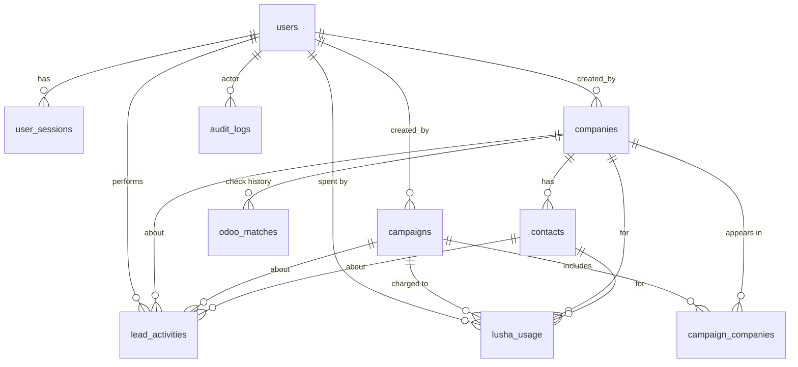

# LeadFinder AI: Architecture (Phase 0)

## 1. Overview

```
┌──────────┐   HTTPS    ┌──────────────────────┐  /api/* (server-side)  ┌──────────────┐     ┌──────────────┐
│ Browser  │ ─────────► │ Next.js (frontend)   │ ─────────────────────► │ FastAPI      │ ──► │ PostgreSQL   │
│          │ ◄───────── │ pages + /api proxy   │ ◄───────────────────── │ (backend)    │     │ 16           │
└──────────┘  cookie    └──────────────────────┘                        └──────┬───────┘     └──────────────┘
                                                                               │ (Phase 1+)
                                                                   integrations/odoo, integrations/lusha
                                                                   (DISCONNECTED in Phase 0)
```

- The backend owns all business rules and permissions. The frontend is a thin client.
- Layers in the backend: **routes** (HTTP only) → **services** (logic, permissions, audit/activity) → **models**.
- The core has no vendor lock-in: plain PostgreSQL, standard containers, open-source frameworks.

## 2. Database schema



| Table | Purpose / key rules |
| --- | --- |
| `users` | LeadFinder accounts. `email` unique (lower-cased). `role` ∈ ADMIN, SALES_MANAGER, SALES_AGENT. `odoo_user_id` nullable link to the Odoo user. Odoo passwords are never stored. |
| `user_sessions` | Server-side sessions. Logout, password reset and deactivation set `revoked_at`. |
| `companies` | **One master record per organisation.** `name` is not unique. `normalized_name`, `domain` and `main_phone_normalized` are indexed for Phase 1 identity resolution. |
| `contacts` | People at a company (company 1─* contacts). `source` / `source_reference` hold the provider-neutral origin and the provider's own id. Phase 0 creates only `MANUAL` contacts. |
| `campaigns` | Targeting definition. `tecomsa_division` ∈ FRINZO, ODOO, IT. `status` ∈ DRAFT, READY, RUNNING, COMPLETED, FAILED, CANCELLED. `target_roles` is JSONB. |
| `campaign_companies` | Links master companies to campaigns without duplicating them. Unique `(campaign_id, company_id)`. `status` ∈ ADDED, REVIEW, REMOVED. `qualification_status` ∈ PENDING, QUALIFIED, DISQUALIFIED. |
| `odoo_matches` | Append-only history of CRM checks. The latest row is the current status. Company creation writes `NOT_CHECKED`. |
| `lusha_usage` | Credit ledger (action, credits, provider request id). Empty in Phase 0. |
| `lead_activities` | Sales-facing event timeline: COMPANY_CREATED, CAMPAIGN_CREATED, COMPANY_ADDED_TO_CAMPAIGN, CONTACT_ADDED, NOTE_ADDED. Timestamped and structured for later ML. |
| `audit_logs` | Security and compliance trail with JSONB `metadata`. Never contains passwords, tokens or secrets. |

Enumerations are stored as `VARCHAR` with `CHECK` constraints, which are easier to evolve than native PostgreSQL
enums. Every timestamp is `timestamptz`.

Normalisation (`backend/app/services/normalization.py`):

- **Name:** accents stripped, lower-cased, punctuation removed, trailing legal suffixes (S.A.L., LLC, Ltd, …) dropped.
- **Domain:** host only, lower-cased, `www.` removed, IDNA-encoded. Invalid values are rejected at input.
- **Phone:** converted to E.164 only when entered in international form (`+…` / `00…`), otherwise `NULL`.

## 3. Authentication and authorization

1. `POST /auth/login` checks the password against its Argon2id hash. Failures take similar time whether or not the
   email exists, and are rate-limited per email and per IP.
2. On success the backend creates a `user_sessions` row and returns a JWT (HS256, `JWT_SECRET`) containing the user id,
   session id and expiry. The token is set as the **httpOnly, SameSite=Lax** cookie `lf_session`, marked `Secure` in
   production.
3. Every request validates the token signature and expiry, then checks that the session row is not revoked or expired
   and that the user is still active. Deactivating a user or changing their password revokes all their sessions
   immediately.
4. `POST /auth/logout` revokes the session and clears the cookie.

CSRF: the cookie is SameSite=Lax, state-changing endpoints accept only JSON (which a cross-site form cannot send
without a CORS preflight), and CORS is restricted to `FRONTEND_URL`.

Authorization is enforced in two places:

- **Role dependencies** (`app/api/deps.py`): `AdminUser`, `ManagerOrAdmin`, `CurrentUser`.
- **Record rules** (`app/services/permissions.py`): agents see and manage only their own campaigns and edit only
  companies they created. A campaign the user cannot see returns 404, so its existence is not revealed.

The Next.js middleware redirects visitors without a session cookie to `/login`. This is only a convenience; the
backend check is the real control.

## 4. API

All list endpoints accept `page` (≥1) and `page_size` (1–100) and return `{items, total, page, page_size}`.

| Method | Path | Access | Notes |
| --- | --- | --- | --- |
| GET | `/health` | public | DB connectivity check |
| POST | `/auth/login` | public | Sets session cookie |
| POST | `/auth/logout` | any | Revokes session |
| GET | `/auth/me` | user | Current user |
| GET | `/users` | admin, manager | `q`, `role`, `is_active` |
| POST | `/users` | admin | |
| GET / PATCH | `/users/{id}` | admin | Activate or deactivate via `is_active` |
| GET | `/companies` | user | `q`, `country`, `industry` |
| POST | `/companies` | user | Normalises, writes `NOT_CHECKED`, activity and audit |
| GET | `/companies/{id}` | user | Includes contacts, campaigns, CRM status, Lusha credits |
| PATCH | `/companies/{id}` | admin, manager, creator | Field-level diff in audit |
| POST | `/companies/{id}/notes` | user | NOTE_ADDED activity |
| GET / POST | `/contacts` | user | `company_id`, `q` filters |
| GET | `/campaigns` | user (scoped) | `q`, `status`, `division`, `mine` |
| POST | `/campaigns` | user | Always created as DRAFT |
| GET / PATCH | `/campaigns/{id}` | owner, manager, admin | Only DRAFT is editable; status DRAFT↔READY, →CANCELLED |
| POST | `/campaigns/{id}/companies/{company_id}` | owner, manager, admin | 409 if already linked |
| GET | `/activities` | user (scoped) | `scope=mine\|all`, `company_id`, `campaign_id` |
| GET | `/audit` | admin | `action`, `entity_type`, `entity_id`, `user_id` |
| GET | `/dashboard` | user | Real counts only |
| GET | `/settings/status` | admin | Version, environment, integration status |

Interactive OpenAPI docs are served at `/docs` outside production.

## 5. Integration architecture

```
backend/app/integrations/
├── base.py          IntegrationNotConfigured
├── odoo/            client.py (transport) · schemas.py (result shapes) · service.py (check_company, find_contact, find_opportunity)
└── lusha/           client.py · schemas.py · service.py (search_companies, search_contacts, reveal_email, reveal_phone)
```

In Phase 0 each service raises `IntegrationNotConfigured` and makes no network calls. Nothing in the application
calls them yet, and no results are simulated. Rules for implementing them:

- Credentials are read server-side from environment variables and never sent to the frontend.
- Provider identifiers are stored as **references** (`odoo_matches.odoo_partner_id`, `contacts.source_reference`,
  `lusha_usage.provider_request_id`), never as LeadFinder primary keys.
- Every credit-consuming Lusha call must write a `lusha_usage` row and respect `campaigns.max_lusha_credit_budget`.
- A failed Odoo check writes `CHECK_FAILED`. It must never write a guessed status.

## 6. Frontend

- `app/login`: public sign-in page.
- `app/(app)/…`: authenticated area wrapped by `components/app-shell.tsx`, which loads `/auth/me` and renders the
  left navigation (Dashboard, Campaigns, Companies, My Activity, and Administration for admins only).
- Pages: dashboard, campaigns (list, new, detail, edit draft), companies (list, new, profile, edit), activity, and
  admin (users, audit log, settings).
- `lib/api.ts`: fetch wrapper. On a 401 it redirects to login, and it maps validation errors to form fields.
